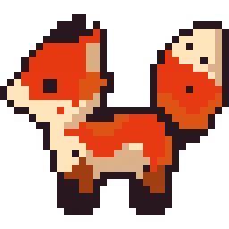

<p align="center">
  
</p>

<div>&nbsp;</div>

**FeXun** is a visual novel engine written in Rust and powered by [Bevy](https://github.com/bevyengine/bevy). The long-term goal of FeXun is to provide an easy-to-use GUI aimed at creators to build Visual Novels with ease. Per the roadmap, FeXun will start as easy-to-use Bevy Plugin so creators and developers can create VNs directly in Rust using Bevy, without all the boilerplate.

## How to use FeXun

Simply add FeXun as dependency and plugin to your Bevy project using `fexun::FexunBevyPlugin`:

```rust
use bevy::app::App;
use fexun::FexunBevyPlugin;

fn main() {
    App::new().add_plugins(FexunBevyPlugin).run();
}
```

```toml
[dependencies]
fexun = "0.1.0"
bevy = { version = "0.20.1", default-features = false }
```

The current crate provides the initial Bevy plugin setup and enables Bevy's 2D, UI, and audio features. Story execution, dialogue UI, and the visual editor are planned features that will be implemented sometime in the future.
